# Registration Committee
## Responsibilities

1. Create the EventBrite event
2. Make changes to EventBrite per decisions made in committee meetings
3. At meetings, update the committee on sales and revenue
4. Monitor CascadiaRCon Gmail for registration-related questions and issues
5. Create discount and scholarship codes
6. Share attendee info as needed (name badges, workshop instructors, etc)

## EventBrite
### Create event

The easiest method to create an event is to copy last year's event. If you are 
joining the committee for the first time, this may have already been done as 
part of the close-out of last year's conf. 

1. Log-in to EventBrite under the CascadiaRCon Gmail account
    - Contact Ellis or Kim for log-in details if needed
2. Go to Manage my events
3. Under the vertical ellipsis, select Copy Event
    - If the event was already created, simply click on the event to open
4. Under Build event page, update:
    - hero image
    - year throughout the test sections
    - date and time. Include the workshop day if applicable
    - venue

This now serves as the basic event page but should not be published until 
conference tickets are updated. See next section.

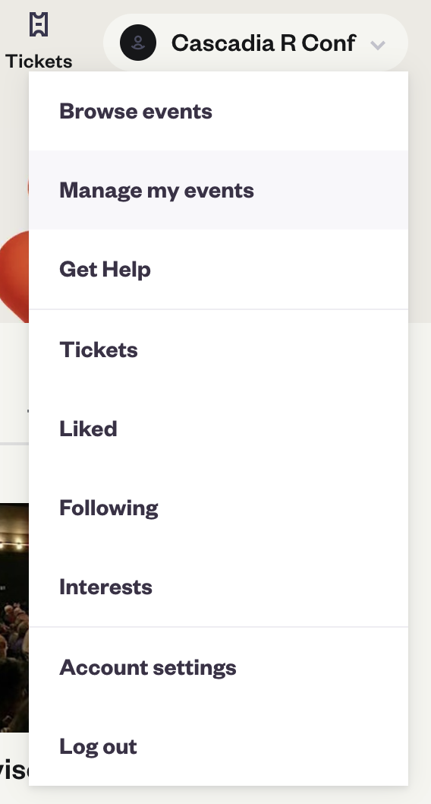 
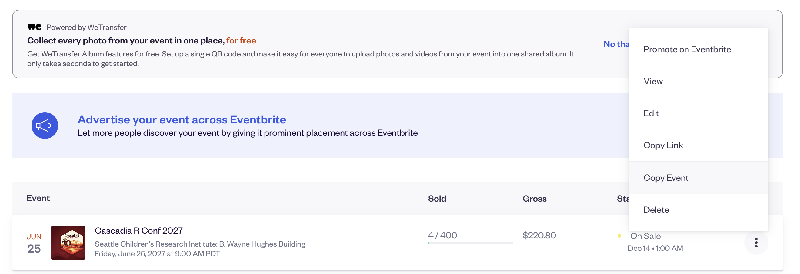 

### Add tickets: Admission (main conf)

Review the prior year's ticket types and add/remove as necessary. We've setup the
tickets to separate in-person and virtual options. Update each ticket type under 
its vertical ellipsis as follows.

1. Select edit  
    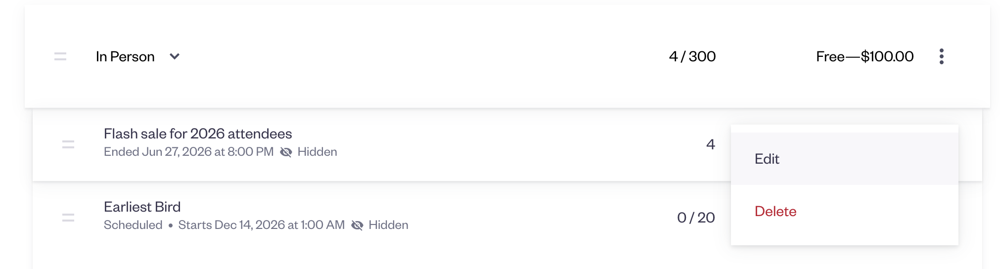 
2. Verify the ticket cost
    - Make sure Free ticket types are marked Free at the top to avoid EventBrite fees
    - All Paid tickets are at a Fixed price  
    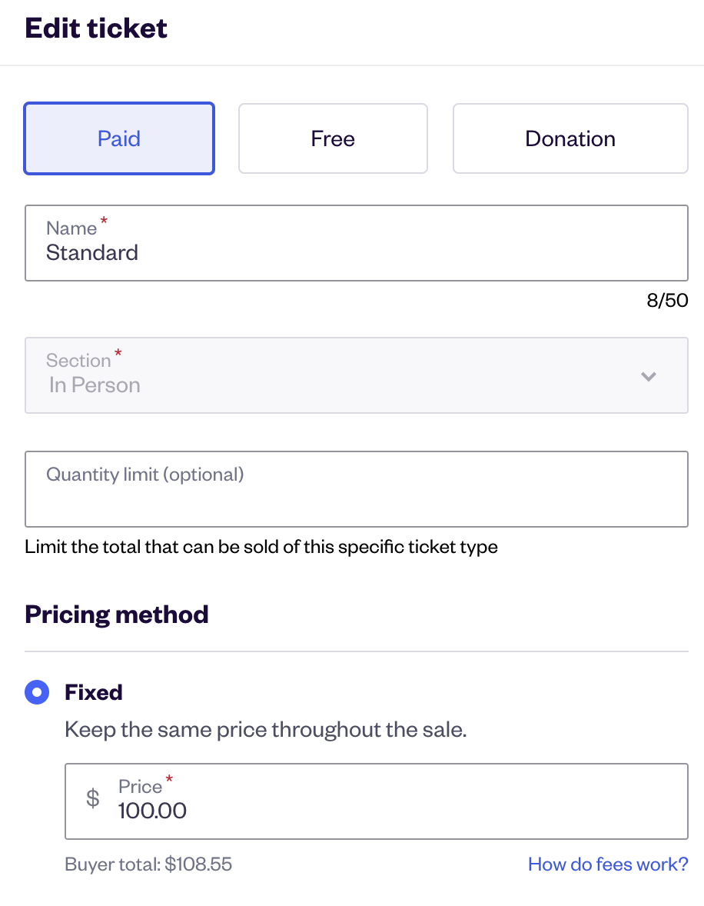 
3. Verify the quantity limit (blank in example above). This applies to early bird, scholarship, and sponsor tickets that have a limited number
4. Set the sales start and end
    - Set early bird dates based on the agreed upon schedule
    - Set the day of ticket to be available during the 2 weeks after all other tickets are closed plus during the first hour of the event
    - All other in-person tickets remain on sale until 2 weeks before the event. We need this window to confirm numbers with catering. See "EventBrite-related requests" for policies on late purchases  
        - Virtual tickets can remain on sale until the day of the event  
    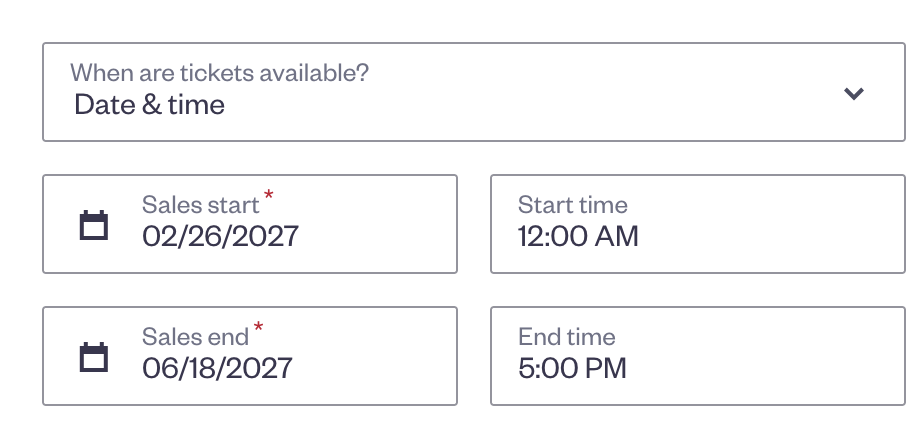 
5. Open the advanced settings. Update the description if needed. Note that many ticket types do not need any description  
    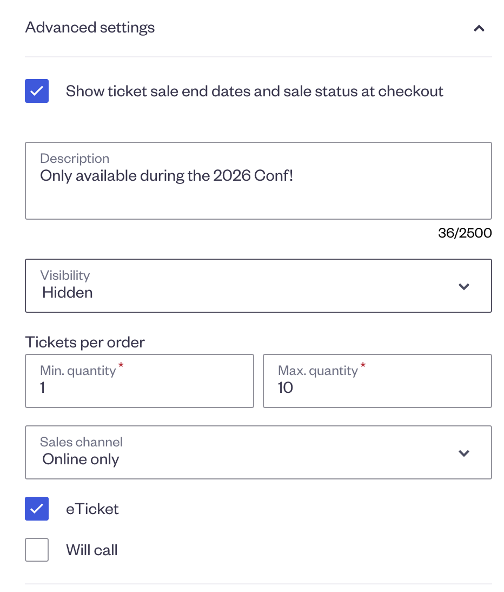 
6. Allow up to 10 tickets per order. This facilities admin purchasing of multiple tickets at once. We tried without it one year and had complaints
7. All sales are online only and eTicket
8. Finally, set the visibility
    - Paid tickets should be Hidden outside the sales dates
    - Free tickets generally require a code and should be set to Hidden. The code then reveals the ticket to the purchaser  
    - Day of tickets are also Hidden  
    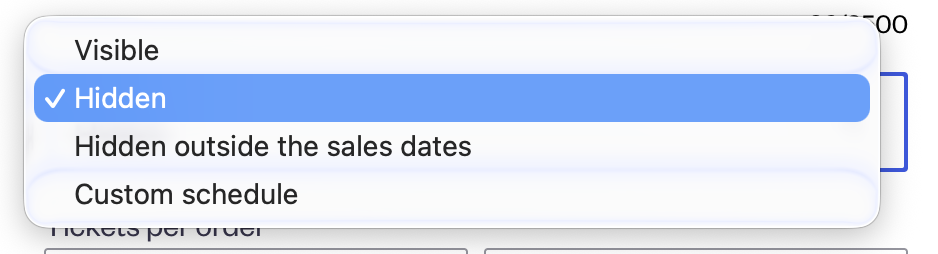 

### Add tickets: Add-ons (workshops)

This will likely occur after tickets are already on sale for the main conf. 
Complete the other setup sections below before publishing the event and return to 
this once workshop info is known.

Switch to the Add-ons tab at the top. Similar to the main conf tickets, we use 
sections here to separate morning and afternoon workshops.

1. Create or update workshops as needed. 
    - We recommend starting each workshop title with the date to help remind people that workshops are a day before the conf. 
    - Make the title short which may require shortening what the instructor uses as their full title
    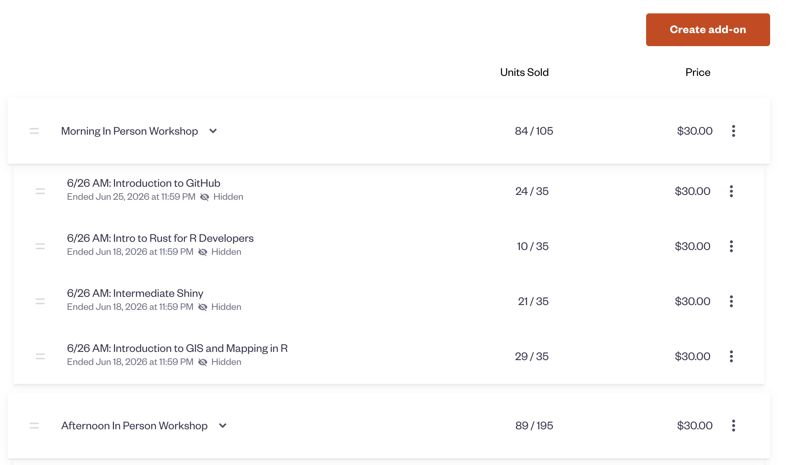 
2. Update each workshop under its vertical ellipsis. 
    - Set the total quantity based on room size or instructor limitations.
    - Set the description with 1 - 2 sentences
    - Put the max quantity at 1. Until the main conf, we need each participant to register separately so that we get an email address to share prep materials
    - Similar to the conference, cut off sales 2 weeks before the event. See "EventBrite-related requests" for policies on late purchases  
    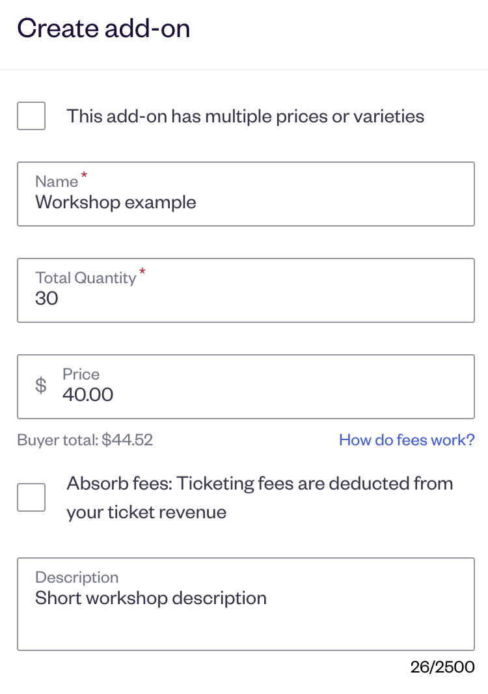 
    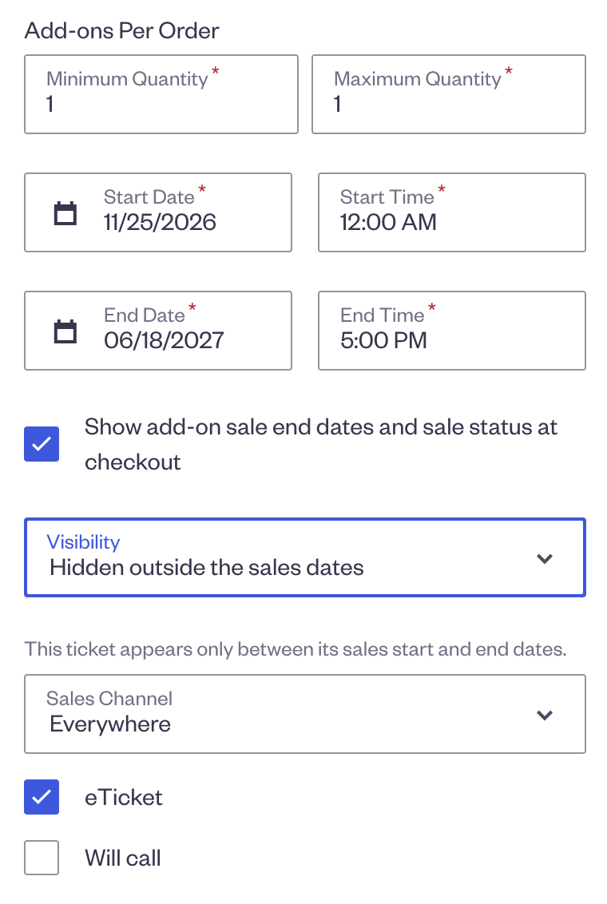 

### Order options
#### Order form

These are the questions asked as part of the ordering process. Make sure it is set 
to collect Each attendee as we need information for name badges.

Review the questions and make edits as desired. Note some questions are set to only
appear with some ticket types (for example, student confirmation with student ticket type).

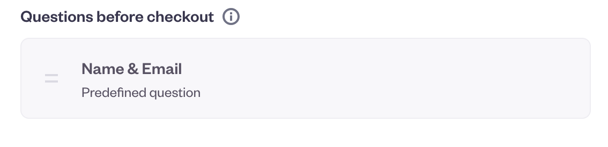
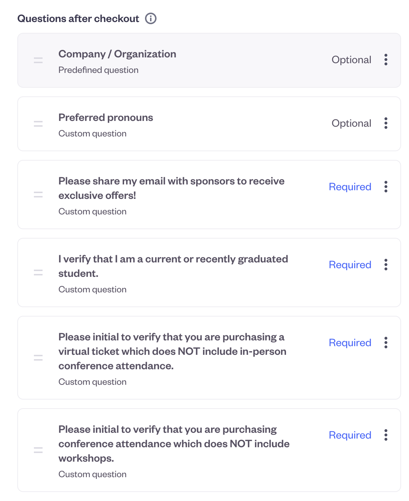 

#### Order confirmation

Update the custom email. Provide just bare bones information in this message. 
An email with more specifics will go out the week of the conference.

#### Waitlist

This is automatically turned on in case we reach capacity. The system automatically
emails the wait-list if tickets become available and gives them 1 day to purchase 
before moving down the list.

### Event finances

Please do not edit anything here. Our nonprofit board members handle this section.

### Marketing

We do not currently use these features but welcome any insights or ideas for how 
leverage them if desired.

### Manage attendees 
#### Emails to attendees

Create emails for the Monday before the event, one for workshops and one for 
the conf.


# EventBrite-related requests

Please monitor the CascadiaRCon Gmail for emails related to EventBrite and registration. In the months leading up to the conf, checking every 2ish weeks is sufficient (basically whenever we have a committee meeting). For the 2 months just before the conf, we recommend checking for frequently as this is when most requests come in.

Below are policies and instructions for the most common requests. Feel free to bring
questions to the committee if you are unsure of any new request.

## Refunds

Currently, we issue all refunds even up to the day of the conf. There are two main ways to get to the refund page:

1. Receive an email directly from EventBrite with purchaser initiated refund request. Simply use the link in the email to go to the refund page. This method locks the "reason for refunding" and selected tickets to what the purchaser requested.
2. Receive a separate email or message directly from the purchaser. In this case, go to Manage attendees -> Manage orders -> Search for their order # or name. Select Actions -> Refund this order (which gets you to the same page as #1)  
    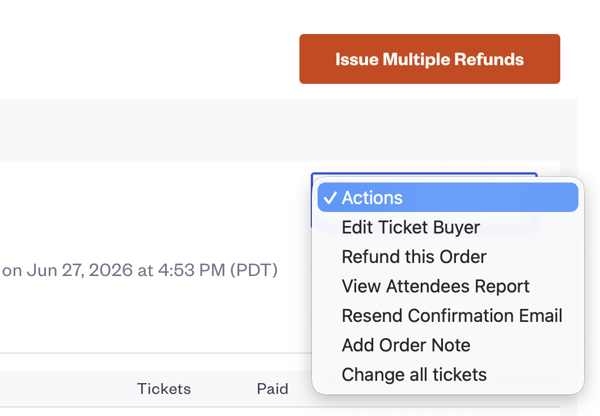 
3. Select the reason and ticket(s) to be refunded. 
    - Note that "duplicate order" is the only option that also refunds the EventBrite fees. Thus, please use this option whenever applicable, for example a speaker needing a refund because they purchased a ticket without using their free ticket code  
    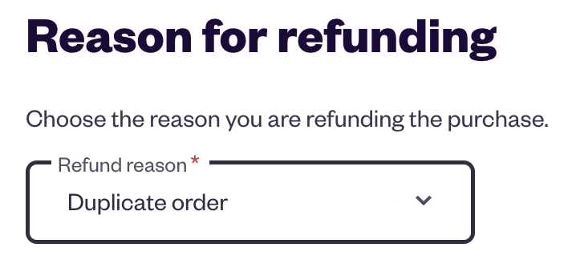 

## Ticket sales closed

During the 2 weeks leading up to the conf after ticket sales have closed, there are 
usually a handful of "Oh no!" emails. We always pad the catering numbers a little
to account for this. So, within reason, issue these individuals a code to use the
"Day-of" tickets for the main conf. Note these are +$10 to discourage 
this from happening.

For workshops, we do not allow late registration, because instructors 
already have the contact list to send out prep information. 

## At capacity but sales are still open

If due to room capacity limit (conf or workshop), convey our apologies and offer 
to place them on the wait-list. 

If a workshop is at the instructor-set capacity (aka less than room capacity),
contact the instructor and ask if it's okay to add 1 person. If they agree, add 
+1 to the workshop's capacity so the ticket is again available. Give the purchaser
only 1 day to use that spot or else we cannot guarantee it isn't 
swooped up by someone else. Please don't repeatedly make this request as the 
workshop will get too large.

## No workshop ticket day-of

We've try our best to convey that workshop tickets are separate from the main conf, 
but this may still happen. 

Because workshops require pre-work, we CANNOT offer day-of workshop tickets. This 
would be unfair to the instructors who prepared for a set class size and sent
out materials days to weeks prior.

## No conference ticket day-of

Again, we've tried but sometimes people still miss that workshop and conf tickets 
are separate. Use the day-of ticket to allow them to register. Consider 
on a case-by-case basis. At a point, we will have to turn people away if we 
reach fire-code capacity or if we're too far over our original catering estimate.

There may also be people who arrive in the hopes of purchasing day-of, because 
they missed the online cutoff. Same rules apply.

## Ticket transfers

Similar to refunds, we allow this. If it's a different person, simply change the 
name and contact email on the order in EventBrite. If it's switching workshops, 
switch the ticket type (as long as new the workshop has space).

# Information requests
## Updates at committee  meetings

Use the event Dashboard to easily report total ticket sales and revenue

## Export attendee info

1. Export the attendee info under Reporting -> Event reports -> Attendees -> Custom Questions Response.  
  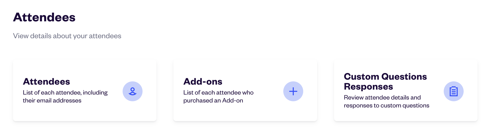 

2. Under Configure Columns, select the following:
    - Order info: Ticket type
    - Attendee info: Custom questions, email, first and last name
    - Ticket buyer info: Email, first and last name 
    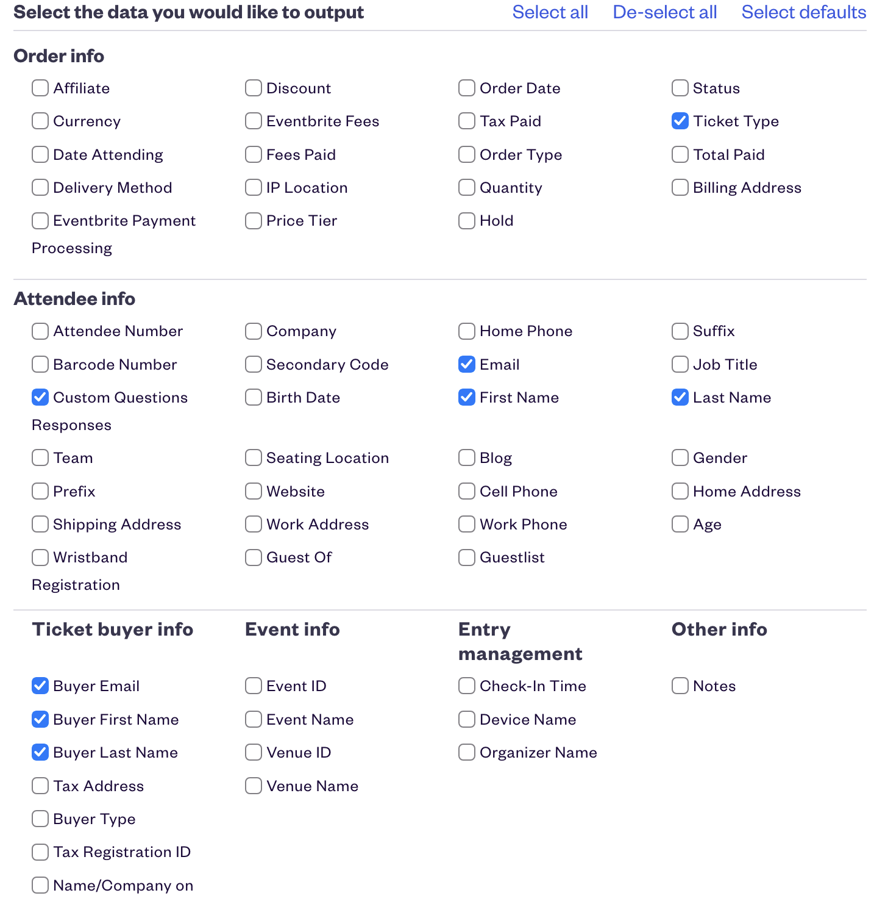 
3. Export to CSV

### For name badges

1. As soon as possible after sales close (2 weeks before event), review the report for any cases of "Info Requested" under the Attendee name columns. This occurs when the purchaser failed to fill out the attendee info. Using the CascadiaRCon email, contact the associated purchaser and ask for the attendee name(s) and optionally, preferred pronouns to be used on name badges. 
    - If you get a response, update the EventBrite order info
    - If no response, leave it. We have extra blank badges for this reason
2. One week before the event, send the final CSV report to whoever is in charge of making name badges.

### For workshop instructors

1. As soon as possible after sales close (2 weeks before event), separate the report per workshop and send a separate report to each instructor with their *attendee email list only*.

# Discount and scholarship codes
## Create codes

You can use whatever method you would like to create unique codes. Create separate files/batches for each purpose (i.e. committee, speaker, scholarship, etc) as you will set specific hidden tickets to each batch of codes.

Here is an R
example. **Please do not** upload this script once you've added your seed or 
the codes to the GitHub repo.

```
#Update as needed
prefix <- "2027CRC_"
total_codes <- 
set.seed()

#Create codes
IDs <- sample(1000:9999, total_codes, replace=FALSE)

paste0(prefix, IDs)

#Save codes
write.table(paste0(prefix, IDs), row.names = FALSE, col.names = FALSE, sep=",",
          paste0(prefix, "codes.csv"))
```

## Add codes to EventBrite

1. Select Add tickets -> Promotions tab -> More options -> Upload a CSV file  
    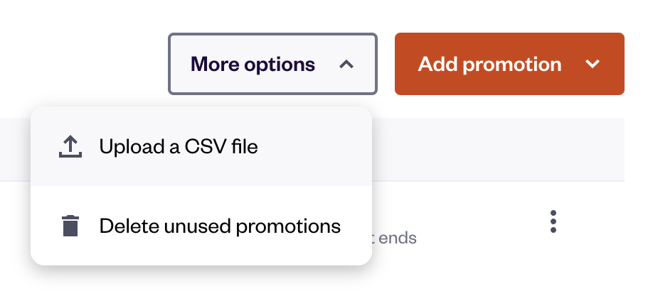
2. Select the CSV with codes, limit each code to 1 ticket, and set to reveal hidden tickets  
    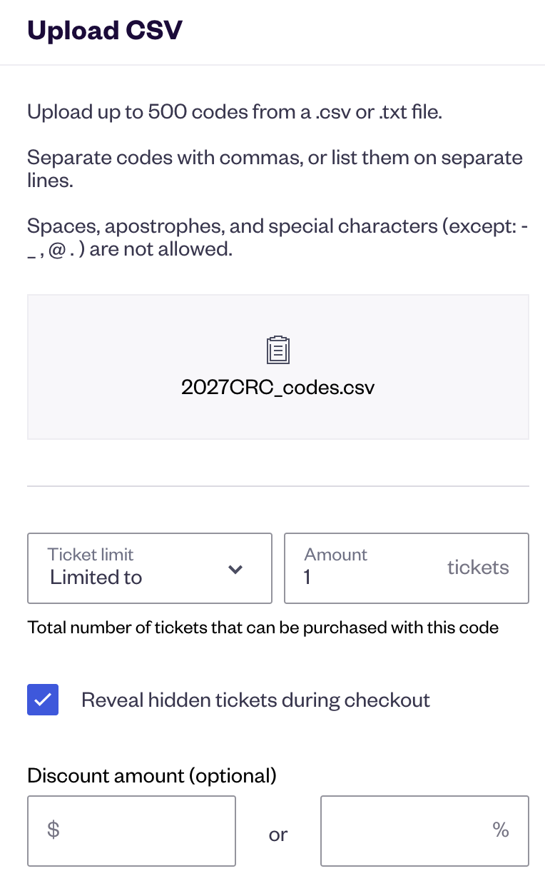
3. Apply code to Only certain hidden tickets and select the appropriate type. Only use 1 type per ticket batch
    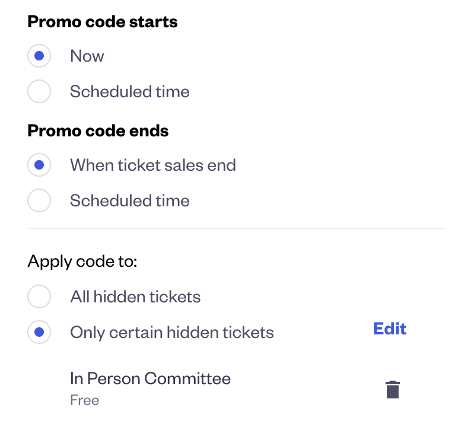
4. For non-unique codes such as a sponsor code to allow up to 5 tickets, you can input a single code under Add promotion -> Add an access or promo code. Use settings similar to batched codes but allow > 1 limit.
